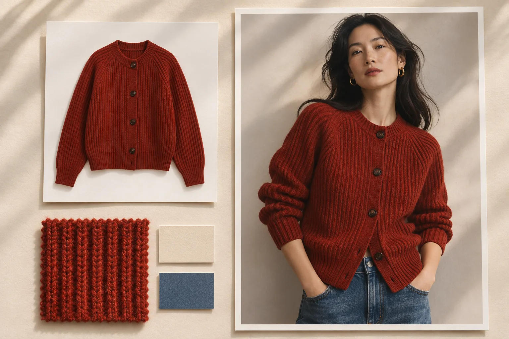

# 森智 AI 电商商品图与批量生图指南

[简体中文](README.md) · [English](docs/en.md) · [日本語](docs/ja.md) · [한국어](docs/ko.md) · [Español](docs/es.md)

森智 AI 为电商和跨境电商团队制作商品视觉素材。一张针织衫平铺图，可以用来准备白底主图、模特试穿图、领口特写和不同市场的场景图。手里有一整个上新文件夹时，可以先核对每款商品和模特的配对，再一次提交整批任务。

[进入工作台](https://www.senzhiai.com/workspace.php) · [API 调用文档](docs/api-zh.md) · [多语言网页版](https://iwkai312.github.io/Senzhi-AI/) · [森智 AI 官网](https://www.senzhiai.com/)

## 🧵 为一个 SKU 准备整套商品图

| 工作台功能 | 准备什么 | 适合拿来做什么 |
| --- | --- | --- |
| AI 替换（1 拖多） | 一张产品图，多张模特或场景参考图 | 看同一件衣服在不同模特身上的效果，或把同款产品放进多个场景。可以在提示词里指定保留姿势、光线和背景。 |
| AI 替换（1 托 1） | 一一对应的商品图和参考图 | 拍摄清单已经配好对时，分别处理每款 SKU，避免把 A 款的服装换到 B 款的参考图里。 |
| 商品买家秀 | 商品图，加上使用场景或人群描述 | 制作生活化的场景素材，例如通勤穿搭、周末出游或家居陈列。用于广告或社媒时，应标明 AI 创作，和真实买家评价区分。 |
| 白底图生成 | 一张能看清轮廓、颜色的商品图 | 把杂乱背景换成干净的商品展示背景。上架前按目标平台规范复核阴影、构图和主体占比。 |
| 细节图生成 | 产品图，最好另有实拍细节参考 | 围绕编织纹理、缝线、纽扣或包袋五金补充细节视角。涉及成分、结构和功能时，以实物为准。 |
| 图文生图（垫图定制） | 参考图，加上想保留和改变的部分 | 同一款商品按不同市场换背景、季节或陈列方式，适合为独立站、货架和广告分别准备素材。 |
| 纯文字生图 | 对主体、视角、光线、色调的描述 | 还在策划拍摄时，先比较棚拍、居家或户外的视觉方向。定稿时再用实物参考校正。 |

## 🖼️ 排详情页、做社媒和视频

**详情页套版**适合已有成熟版式的店铺。把参考版式和新商品素材放入工作台，按需要生成同风格图片。**详情页制作**则提供画布，方便自己决定图片顺序、编辑版式并导出。比如给一款开衫排详情页，可以从模特全身图开始，接领口、袖口细节，再放自己的尺码表。

**小红书内容创作**可以围绕一款商品准备图文选题、配图与文案草稿。给英语市场做素材时，也可以在提示词里写清受众、语言和使用场景，再由运营核对译文、单位和商品卖点。

**视频生成**适合把静态参考图转成短片，例如让镜头从针织衫全身缓慢推进到领口。先选视频模型，再按该模型支持的时长、分辨率和参考图上限提交；这些参数会影响报价。

## 🧩 批量生图：3 款针织衫 × 10 张模特图

1. 打开「批量生图」，选择能接收至少两张参考图的模型。第一列放三款针织衫，第二列放十张模特图。支持选文件夹、多选图片、粘贴、拖入，也能调整列顺序。**从左到右就是提示词里的图 1、图 2。**
2. **全部组合**会生成 30 个任务组，每组是一款衣服和一张模特图。如果搭配表已经逐行排好，就用**按顺序配对**。要让每组都带同一个品牌背景，就再加一列**固定图片**；按顺序配对时，多张固定图会按顺序循环。
3. 写下共用要求，例如「把图 1 的开衫穿到图 2 的模特身上，保留原姿势、领口织纹和纽扣颜色」。开启**逐组优化**后，每组会结合自己的参考图优化提示词。只需严格执行同一句要求时，也可以直接用原稿。
4. 在预览里抽查首组、末组和中间一组，核对列顺序、是否缺图、组数和预计积分。可立即开始或预约执行。**等整批素材上传并确认后再关电脑**；已确认的预约批次会在后台先做已开启的优化，到预约时间再生图。
5. 在批次里看每组进度。可选备用模型处理明确失败的任务，单组失败后可按界面提示重试。遇到提交结果暂未同步，先查询原任务，避免为同一张图重复下单。

一个模型如果最多支持 10 张参考图，5 列 × 100 行就是 **100 个任务，每个任务 5 张图**。挑模型看的是每组的列数；核对整批成本看的是有效组数、分辨率和优化选项。[打开批量生图](https://www.senzhiai.com/workspace.php?tool=folder_batch)

## 🔍 模型、4K 与原图交付

| 用途 | 模型示例 | 怎么选 |
| --- | --- | --- |
| 商品图、换装、场景变体 | `nano-banana-pro`、`nano-banana-2`、`nano-banana-2.1`，以及 GPT Image 2.5 Sunburst / Flare 的 VIP 版本 | 同一款商品先试一组，放大比较领口纹理、纽扣位置和背景保持情况，再决定用哪个模型跑整批。 |
| 提示词与文字 | `gpt-6.1-sol`、`gemini-3.8-flash`；API 另有 `gemini3.1-flash` | 用产品资料写文案，或给批量任务逐组优化提示词。工作台按具体功能列出可选模型。 |
| 视频 | MiniMax H3、Agnes Video 2.5 | H3 支持最多 9 张参考图、最高 1080p；Agnes 支持最多 5 张、最高 2K。按任务需要选择。 |

**4K 交付按模型能力来。** 选择支持 4K 的图片模型和 4K 档位，森智按这个档位请求生成，下载交付模型返回的原图。森智不把低分辨率结果在平台端超分放大后当作 4K 原图交付。列表缩略图用于浏览，验图请点「下载原图」，在文件属性里核对像素，再放大检查织纹、印花和小字。画幅比例不同，宽高也不同。

模型可用性、参考图上限和积分随账号、场景及档位变化。2026 年 11 月 6 日核对时，开放 API 目录有 9 个图片展示项和 3 个文字模型。上述两款视频模型可在网页使用；API 目录开放视频模型后，调用方可沿用同一套提交和查询流程。接入时请以自己的实时目录为准。

## 📦 交付与任务追踪

截至 2026 年 11 月 6 日，已有**超过 40 个非管理员账号**在森智完成过生成任务，按账号去重。日常上新时，美工可以在「资产中心 → 图片空间」按功能筛选，运营只勾选要上架的几张，或将整批原图打包成 ZIP。生成图片请在 **5 天内**下载并自行备份；把选定的成片按 SKU 存入团队自己的素材库，方便下次换市场或改版时复用。

批次会保留各组的进度、结果和失败状态。上传并确认后，关闭工作台也能继续后台处理。需要客服协助时，从任务记录反馈并附任务编号，便于核对具体的一组。对每天都要交图的团队，这些机制让中途断网、部分失败或交接班后的工作都可以接着做。

## 🔌 API、飞书多维表格与 ComfyUI

- **接 ERP、独立站或自有商品库。** 用 API 查可调用模型和参数，再用 SKU 的素材与提示词提交，把响应中的 `request_id` 存回商品记录，完成后保存结果。适合按商品目录驱动工作。[阅读中文 API 调用指南](docs/api-zh.md)
- **飞书多维表格。** 一行放一款商品，建「SKU、图片地址、提示词、请求编号、状态、成片」等字段。用自动化的「发送 HTTP 请求」提交，把 `request_id` 写入请求编号，再用它查询并回填结果。密钥放在受控的请求配置里，给森智的素材 URL 需在任务处理期间可读取。
- **ComfyUI。** 工作台提供 Bridge 插件下载和安装说明，可用图片、文本、文本预览和配置节点，把商品图或提示词接入现有工作流。比如先用文字节点整理要求，再让图片节点生成变体，继续用你常用的保存节点输出。[打开插件与 API 工作台](https://www.senzhiai.com/workspace.php?tool=open_api)

第一次用可以先以访客身份浏览工作台。准备好一款商品、两张参考图，登录后做一个小批次，检查原图和积分，再扩大到整批上新。[进入森智 AI](https://www.senzhiai.com/workspace.php)
