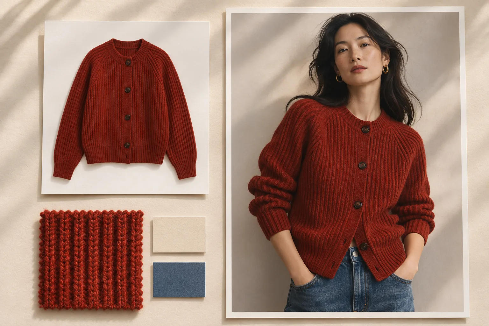

# Senzhi AI (森智 AI) for e-commerce product photography, virtual try-on and batch generation

[简体中文](../README.md) · [English](en.md) · [日本語](ja.md) · [한국어](ko.md) · [Español](es.md)

Senzhi AI helps e-commerce and cross-border retail teams turn product photos into listing images, virtual try-on shots and short videos. Take a cardigan launch. A flat lay can supply the product reference for a clean catalog shot, a photo on a model or a campaign set in a different market. If you have a whole season of samples, you can check the pairings as a batch before sending them to production.

[Explore the workspace](https://www.senzhiai.com/workspace.php) · [Read the API guide](api-en.md) · [Senzhi AI website](https://www.senzhiai.com/)

## 🧵 Build the image set for one SKU

| Workspace tool | What to bring | What to make |
| --- | --- | --- |
| Virtual try-on and product replacement, one to many | One garment or product shot, plus several model or scene references | Show one item on different models or in different settings. Tell the model which pose, lighting and background to keep. |
| Product replacement, one to one | A list of product shots with a matching reference for each | Follow a prepared shot list. For example, pair the cream cardigan with its front view and the navy one with its side view. |
| Lifestyle imagery | A product photo and a description of the intended setting | Place a tote on a café table or style a jacket for a commute. Label AI styling shots when presenting them alongside genuine customer photos. |
| White-background images | A clear view of the product outline and color | Make a clean image for a marketplace listing. Check the crop, subject size and shadow against the destination store’s requirements. |
| Product details | A product shot and close-up reference photos where possible | Show a cuff, a button, a closure or the texture of a knit. Compare details with the physical sample before publishing. |
| Image-guided generation | A reference image and instructions on what to retain or change | Keep the product and composition while adapting the background, season or styling for a new market. |
| Text-to-image | A description of the subject, composition, lighting and mood | Compare concepts for a campaign before a shoot. Bring product references into the next round when the result must match a real SKU. |

## 🖼️ Make product pages, social posts and short videos

Use **detail-page templates** when a store already has a visual style. Supply a layout reference and the new product photos to generate material in that style. Use the **detail-page canvas** to arrange the finished images yourself. For a cardigan, you might lead with the full-length look, follow with the collar and cuff, and end with the size chart you maintain for that market.

The **Xiaohongshu (RedNote) content tool** helps draft copy and visuals around a product or a styling idea. For a cross-border campaign, specify the destination market, language and season in the brief. Have a local reviewer check garment measurements, translated claims and text in the final image.

Use **video generation** when motion adds information, such as a camera move from the full outfit to the collar. Select a video model before choosing duration, resolution and reference images. The supported combinations and credit estimate depend on the model.

## 🧩 Batch a launch with three cardigans and ten model photos

1. Open **Batch generation** and choose a model that accepts at least two reference images. Place three garment photos in the first source column and ten model photos in the second. You can import folders, drag in photos or paste images. Rearrange the columns before submitting. **The column order defines image 1, image 2 and so on in your prompt.**
2. Choose **All combinations** for 30 groups, each containing one garment and one model photo. If a buyer has specified the exact outfit for each shot, choose **Pair in order** to match the images row by row. Add a **fixed image** column to reuse one studio background in every group. In row-by-row mode, multiple fixed references cycle through the groups.
3. Write the shared brief. For example, “Dress the person in image 2 in the cardigan from image 1. Keep the pose, the collar stitching and the button color.” Enable **prompt optimization per group** if you want each instruction tailored to its own reference set.
4. Inspect groups near the beginning, middle and end. Check missing references, the total number of groups and the estimated credits. Start immediately or schedule a time. **Keep the browser open until all uploads are confirmed.** A confirmed scheduled batch can optimize the prompts ahead of time and start generation at the scheduled time, even after you shut down your computer.
5. Review progress by group. You can configure a backup model for confirmed failures and retry an eligible failed group on its own. If a result is slow to sync, look up the original task before submitting another. Successful groups can continue independently.

A ten-image model limit applies to each task. Five source columns paired across 100 rows make **100 tasks with five references each**. Review the number of valid groups, resolution and prompt optimization when estimating the cost of the run. [Open batch generation](https://www.senzhiai.com/workspace.php?tool=folder_batch)

## 🔍 Choose a model and check the 4K original

| Job | Examples in the workspace | What to compare |
| --- | --- | --- |
| Product images and try-on | `nano-banana-pro`, `nano-banana-2`, `nano-banana-2.1`, and the GPT Image 2.5 Sunburst and Flare VIP editions | Try the same garment and reference in a small run. Compare the neckline, placement of buttons and preservation of the pose before assigning the full catalog. |
| Prompt optimization and copy | `gpt-6.1-sol` and `gemini-3.8-flash` for prompt optimization. The API text catalog also lists `gemini3.1-flash`. | Use a text model to refine each group’s instructions or draft product copy from facts you supply. |
| Video | MiniMax H3 and Agnes Video 2.5 | H3 accepts up to nine reference images and offers up to 1080p. Agnes accepts up to five and offers up to 2K. |

**When you select 4K on a supported image model, Senzhi requests that resolution and delivers the original file returned by the model.** Senzhi does not upscale a lower-resolution result on its own servers and label it a 4K original. The exact pixel dimensions vary by model and aspect ratio. Download the original to check its dimensions and inspect stitching, printed lettering or a logo at full size. The gallery thumbnail is optimized for browsing.

The November 6, 2026 check found nine image entries and three text models in the public-facing API catalog for the account tiers checked. Both video models above were available in the web workspace. The API supports video tasks when your account’s catalog lists an available video model. Check the live model list for current availability, input limits and pricing. [See how to list models](api-en.md)

## 📦 Track work and hand off the originals

As of November 6, 2026, **more than 40 distinct non-admin accounts** had completed a generation task on Senzhi. For teams with a daily listing deadline, the batch record shows which groups have finished, which are still running and which need another look. After uploads are confirmed, server-side processing continues across a shift change or a closed browser. If you need help, include the task number when contacting support.

In **Asset Center → Image Library**, filter recent outputs by tool, select the approved shots or select all, and download the originals together as a ZIP. Save and back up the images **within five days**. Organizing the files by SKU and market makes it easier to reuse a campaign when the listing changes.

## 🔌 Connect an ERP, Feishu Base or ComfyUI

- **Storefronts, ERPs and catalog systems.** Fetch the models available to your account, submit one task per SKU and store the returned `request_id` alongside the product record. A later lookup can retrieve the result for your asset library. The guide includes authentication, image and text examples, video parameters and how to retry a request safely. [API guide](api-en.md)
- **Feishu Base (Lark Base).** Give each row fields for the SKU, accessible reference-image URL, prompt, `request_id`, status and final asset. Use the automation’s HTTP request action to submit the task. A separate scheduled workflow can look up the task and write the outcome back to the same row. Keep the API key in a restricted integration setting.
- **ComfyUI.** The API workspace provides a downloadable bridge plugin with image, text, text-preview and configuration nodes. For example, refine a product brief in a text node, send it to an image node and pass the output to your usual save step. [Open the API and plugin workspace](https://www.senzhiai.com/workspace.php?tool=open_api)

You can explore the workspace as a guest. To try a first run, sign in, choose one SKU and two reference photos, and check the estimated credits and downloaded original before scaling up. [Open Senzhi AI](https://www.senzhiai.com/workspace.php)
