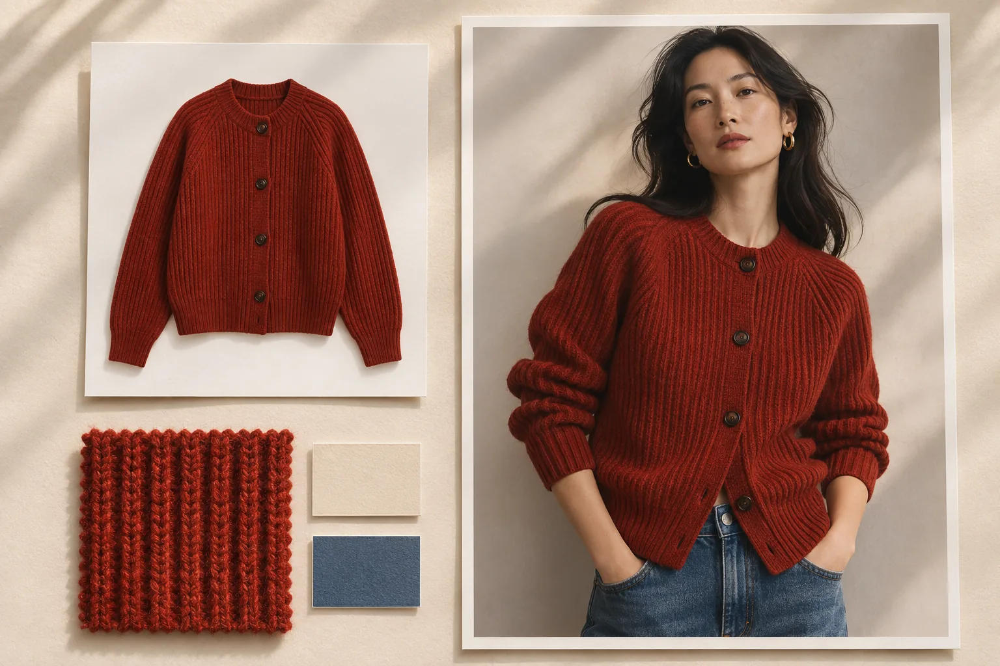

# Senzhi AI (森智 AI) para imágenes de producto, catálogos y vídeo

[简体中文](../README.md) · [English](en.md) · [日本語](ja.md) · [한국어](ko.md) · [Español](es.md)

Senzhi AI ayuda a las tiendas en línea y a los equipos que venden en varios países a preparar el material de una ficha de producto. Con las fotos de una misma prenda puedes crear la imagen de catálogo, un detalle del tejido y varias tomas con modelos. Si la colección llega en tres colores, puedes organizar las tres referencias en un solo lote.

[Visitar el sitio oficial](https://www.senzhiai.com/) · [Abrir el espacio de trabajo](https://www.senzhiai.com/workspace.php) · [Guía de la API en español](api-es.md)

## Qué herramienta usar para cada pieza

| Pieza | Cómo prepararla |
| --- | --- |
| Foto de catálogo sobre fondo blanco | Sube una foto del artículo y genera una vista sobre fondo blanco. Es una opción para presentar una colección con el mismo tratamiento de fondo y comparar siluetas o colores. |
| Detalle de producto | Aporta una referencia donde se aprecie lo que quieres mostrar, como una cremallera, un bordado o el puño de una chaqueta. Indica qué zona debe ocupar el primer plano para acompañar la descripción del artículo. |
| Prueba virtual y sustitución de producto | Combina la foto del producto con una toma de referencia. Puedes preparar una pareja concreta de prenda y modelo, o probar la misma prenda sobre varias personas conservando la pose indicada. |
| Producto en uso | Parte de una foto y describe un contexto reconocible para quien compra. Un bolso colocado junto a un abrigo, por ejemplo, ayuda a presentar una idea de conjunto. |
| Ficha de producto y composición | Usa una página de referencia como plantilla para una serie de artículos o asigna una plantilla distinta a cada uno. En el editor de lienzo puedes colocar imágenes y textos y exportar la composición entera o por secciones. |
| Creatividad de campaña y redes | Explora una escena a partir de un texto o lleva una foto de referencia a una nueva composición. La herramienta para Xiaohongshu (RED) recibe por separado las indicaciones sobre la imagen y sobre el texto de la publicación. |
| Vídeo corto | Describe el movimiento del artículo o de la cámara y, si el modelo admite referencias, añade tus fotos. Una toma que se acerque al tejido puede complementar las fotos fijas de la ficha. |

## Un lote de 3 prendas y 10 fotos de modelos

1. **Organiza los archivos.** En «批量生图» (generación por lotes), coloca las fotos de tres prendas en la primera columna y diez fotos de modelos en la segunda. Puedes incorporar carpetas completas y reordenar las columnas o las fotos en la vista previa. La numeración de las imágenes sigue el orden de las columnas.
2. **Elige el emparejamiento.** Con «全部组合» (todas las combinaciones) cada prenda se combina con cada modelo, para un total de **30 grupos**. Si el equipo de catálogo ya ha asignado una foto de modelo a cada prenda, elige el emparejamiento por orden. La primera foto de cada columna formará la primera fila.
3. **Escribe la instrucción común.** Por ejemplo, «Pon la prenda de la imagen 1 a la persona de la imagen 2. Conserva el cuello y la textura del punto, así como la pose y el fondo de la segunda foto». Activa la optimización por grupo si quieres que la instrucción se adapte a las referencias de cada pareja.
4. **Revisa el coste y la hora.** Comprueba el número de grupos y los créditos estimados antes de confirmar. Para ejecutar el lote más tarde, programa una hora y termina de subir los archivos. Si has activado la optimización, las instrucciones se preparan una vez confirmado el lote completo y la generación de imágenes empieza a partir de la hora programada. Una vez confirmada la carga, puedes apagar el equipo.

Si el fondo se repite en todo un catálogo, añade una columna de **imágenes fijas** al emparejar por orden. Una sola referencia se usa en cada fila. Varias referencias se reutilizan en el orden elegido y vuelven a empezar al agotarse. [Abrir la generación por lotes](https://www.senzhiai.com/workspace.php?tool=folder_batch)

## Modelos, resolución y originales

Para imagen, el catálogo de Senzhi AI incluye opciones como `nano-banana-pro`, `nano-banana-2`, `nano-banana-2.1`, variantes VIP de GPT Image 2.5 (Sunburst y Flare) y GPT Image 2.0 VIP. En vídeo, MiniMax H3 admite hasta nueve imágenes de referencia y resolución de hasta 1080p. Agnes Video 2.5 admite hasta cinco imágenes y resolución de hasta 2K. Comprueba los modelos, formatos y precios que aparecen en tu cuenta para la herramienta elegida.

Para optimizar instrucciones puedes elegir `gpt-6.1-sol` o `gemini-3.8-flash`. Si preparas varias prendas del mismo corte en distintos colores, el modelo puede adaptar la instrucción común a las fotos de cada grupo.

Al seleccionar 4K en un modelo compatible, Senzhi AI solicita la generación en ese modo y entrega el archivo original que devuelve el modelo. La plataforma no amplía una imagen de menor resolución para venderla como 4K. Descarga el archivo desde la biblioteca de imágenes para comprobar sus dimensiones en píxeles, revisar el color y comparar los detalles con la prenda real. Puedes filtrar los resultados por herramienta y descargar solo las tomas aprobadas en un ZIP. El plazo de conservación anunciado es de cinco días. Guarda los originales que quieras reutilizar.

Hasta el 6 de noviembre de 2026, más de 40 cuentas de usuario, excluidas las de administración, habían completado al menos una generación. El historial muestra el estado de cada grupo por separado. Si se interrumpe la consulta, el sistema vuelve a comprobar la tarea original. Un grupo con un fallo confirmado puede reintentarse sin volver a enviar los que ya han terminado. También puedes configurar un modelo de reserva al preparar el lote.

## API, Feishu Base y ComfyUI

La API permite solicitar imágenes y texto desde tu propio catálogo o aplicación. El 6 de noviembre de 2026, el catálogo de la API mostraba nueve entradas de imagen y tres de texto, entre ellas `gemini3.1-flash`. El protocolo también contempla vídeo. Actualmente, los modelos de vídeo se utilizan desde el espacio de trabajo web. Consulta la lista con la clave de tu cuenta para conocer los parámetros y precios disponibles. Asocia el `request_id` de cada solicitud con la referencia del producto para devolver el resultado al SKU correcto.

- **Feishu Base (飞书多维表格).** Prepara columnas para SKU, URL de referencia, instrucciones, `request_id` y resultado. Configura el paso «发送 HTTP 请求» (enviar una solicitud HTTP) en tu automatización, guarda el identificador y escribe el resultado en la misma fila al confirmar que la tarea ha terminado. Guarda la clave en la configuración de una automatización con acceso restringido o en tu servidor.
- **ComfyUI.** En la sección de API del espacio de trabajo encontrarás el complemento y sus instrucciones de instalación. Extrae la carpeta del complemento en `ComfyUI/custom_nodes/`, instala las dependencias que indica la guía y reinicia ComfyUI. Busca «森智AI» o «NewAPI» para encontrar los nodos de imagen, texto, vista previa del texto y configuración. Borra la clave antes de compartir el archivo del flujo de trabajo.

[Guía de la API en español](api-es.md) · [Guía de la API en chino](api-zh.md) · [Modelos y complemento ComfyUI](https://www.senzhiai.com/workspace.php?tool=open_api)
