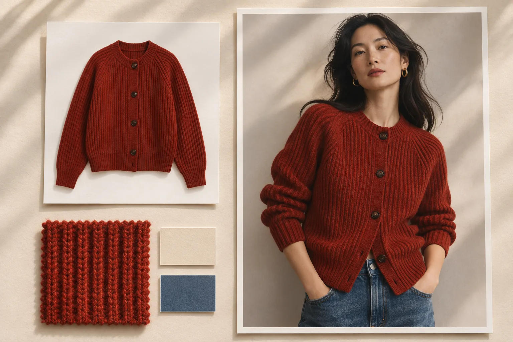

# 森智 AI（Senzhi AI）｜EC・越境EC向けの商品画像と動画制作

[简体中文](../README.md) · [English](en.md) · [日本語](ja.md) · [한국어](ko.md) · [Español](es.md)

森智 AI は、EC・越境ECの出品担当者や制作チームが、手元の商品写真からカタログ画像、着用イメージ、商品ページ、販促用動画を作るためのワークスペースです。たとえば新作のカーディガンを登録するとき、商品一覧には白背景の正面カットを、詳細ページには編み地のアップを、SNSには着用シーンを用意できます。

[公式サイト](https://www.senzhiai.com/) · [ワークスペースを試す](https://www.senzhiai.com/workspace.php) · [開発者向けAPIガイド](api-ja.md)

## 商品に合わせて制作ツールを選ぶ

| 作りたいもの | 用意するものと制作の流れ |
| --- | --- |
| 白背景の商品画像 | 商品写真をアップロードし、背景を白にそろえたカットを生成します。色違いの商品を一覧に並べたときも、各商品のシルエットを比較しやすくなります。 |
| 商品のディテールカット | 袖口、ボタン、金具など、見せたい部分が写った写真を入力します。拡大して見せる箇所を指定し、詳細ページに添えるカットを作ります。 |
| 着用イメージ・商品差し替え | 商品の写真と、構図やポーズの参考にする写真を用意します。1対1で着用例を作るほか、同じ服を複数のモデル写真に合わせて比較できます。 |
| 使用シーンのイメージ | 商品写真をもとに、日常で使う場面を指定します。たとえばバッグをカフェの椅子に置いた販促用カットを作れます。 |
| 商品詳細ページ | 既存の見本画像と商品写真を組み合わせ、シリーズでレイアウトをそろえます。文字や画像の位置を自分で決めたいときは、キャンバス上で編集し、ページ全体または分割画像を書き出せます。 |
| 広告・SNS用の素材 | テキストから新しい構図を試したり、参考画像を添えて販促ビジュアルを作ったりできます。小紅書（RED）向けの制作ツールでは、画像の雰囲気と投稿文への指示を別々に指定できます。 |
| 商品紹介動画 | 動きやカメラワークを文章で伝え、対応モデルでは参考画像も追加できます。たとえば「正面から袖口へゆっくり寄る」と指示し、モデルで選べる尺と画質で短い商品動画を作ります。 |

## 3着のニットを10人のモデルに合わせる

1. **素材を並べます。** 「批量生图」（一括生成）で、1列目にニット3点、2列目にモデル写真10枚を追加します。フォルダーをまとめて選ぶこともできます。プレビューで写真や列を並べ替えると、「画像1」「画像2」もその順番になります。
2. **組み合わせ方を決めます。** 「全部组合」（すべての組み合わせ）を選ぶと、ニット1着につき10枚のモデル写真を使い、合計30組になります。「按顺序配对」（順番に組み合わせる）では、各列の1枚目同士、2枚目同士が1組になります。SKUごとに使う写真が決まっているときに向いています。
3. **共通の指示を書きます。** たとえば「画像2の人物に画像1のニットを着せてください。襟の形と編み柄を保ち、人物のポーズと背景は元の写真に合わせてください」。組ごとに指示を調整したい場合は、プロンプトの自動最適化を有効にします。
4. **見積もりと実行時間を確認します。** 組数、モデル、ポイントを確かめ、すぐに開始するか日時を予約します。予約と自動最適化を併用すると、全素材のアップロード確認後に各組の指示文を準備し、予約時刻から画像生成に進みます。アップロード完了後は、パソコンを閉じても処理が続きます。

毎回同じ撮影背景を使うなら、順番に組み合わせるモードで「固定图片」（固定画像）の列を追加します。背景1枚なら全組で共用し、2枚以上なら登録した順に繰り返します。1枚の参照画像を各行へ入れ直す手間が省けます。[一括生成を開く](https://www.senzhiai.com/workspace.php?tool=folder_batch)

## モデル選びと4Kの原寸ファイル

画像生成では `nano-banana-pro`、`nano-banana-2`、`nano-banana-2.1`、GPT Image 2.5のVIPモデル（Sunburst・Flare）、GPT Image 2.0 VIPなどを扱っています。動画はMiniMax H3が最大9枚の参考画像と最高1080p、Agnes Video 2.5が最大5枚と最高2Kに対応します。実際に選べるモデル、パラメーター、必要なポイントはアカウントの各ツールで確認できます。

指示文の調整には `gpt-6.1-sol` と `gemini-3.8-flash` を利用できます。たとえば色違いのニットを一括で扱うときに、各組の商品とモデル写真をもとに共通の制作指示を調整できます。

対応モデルで4Kを選ぶと、森智 AI はそのモデルの4K設定で生成を依頼し、返ってきた元画像をそのまま提供します。低解像度の結果を森智 AI 側で引き伸ばして4Kとして提供することはありません。「图片空间」（画像スペース）から原寸でダウンロードし、ピクセル寸法を確認したうえで、生地の色や襟の形、縫い目を商品写真と見比べてください。画像スペースでは制作ツール別に結果を絞り込み、採用したカットだけを選んでZIPにまとめられます。生成画像の保存期間は5日間と案内しています。使いたい原本は商品管理用のフォルダーへ保存してください。

2026年11月6日までに、管理者を除く40を超えるアカウントで生成が完了しています。まとめて依頼した場合も進行状況は組ごとに確認できます。結果の照会が一時的に途切れた場合は同じ依頼を再照会します。失敗が確定した組は個別に再試行でき、事前に予備モデルを選んだ場合は、その設定に従って次の試行に進みます。

## API、飛書多維表格、ComfyUIとの連携

自社の商品管理システムから画像生成やテキスト生成を依頼できます。2026年11月6日時点のAPIモデル一覧には画像9件とテキスト3件が掲載されています。テキストには `gemini3.1-flash` もあります。動画も扱えるAPI仕様ですが、現在の動画モデルはワークスペースで利用できます。まずアカウントのAPIキーで最新の一覧を取得し、用途、対応パラメーター、ポイントを確認してください。SKUと応答の `request_id` を対応付けると、結果の取り込み先が明確になります。

- **飛書多維表格（Feishu Base）との接続**　SKU、画像URL、制作指示、`request_id`、結果の列を用意します。表の自動化に「发送 HTTP 请求」（HTTPリクエストの送信）を組み込み、生成を依頼します。保存した `request_id` で完了を確認したら、結果を同じ行に書き戻します。APIキーはアクセスを制限した自動化の設定やサーバー側に保管してください。
- **ComfyUI用プラグイン**　ワークスペースのAPI画面からダウンロードできます。展開したプラグインのフォルダーを `ComfyUI/custom_nodes/` に入れ、案内に従って依存パッケージをインストールして再起動します。「森智AI」または「NewAPI」で検索すると、画像・テキスト生成、テキストのプレビュー、接続設定のノードを選べます。ワークフローを共有する際はAPIキーを消去してください。

[開発者向けAPIガイド](api-ja.md) · [APIガイド（簡体中国語）](api-zh.md) · [アカウントで使えるモデルを確認する](https://www.senzhiai.com/workspace.php?tool=open_api)
