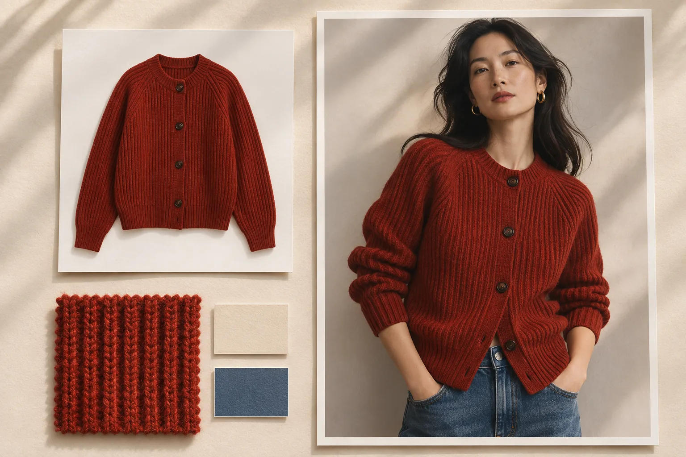

# Senzhi AI(森智 AI) | 쇼핑몰 상품 이미지와 영상 제작

[简体中文](../README.md) · [English](en.md) · [日本語](ja.md) · [한국어](ko.md) · [Español](es.md)

Senzhi AI는 국내외 온라인몰에서 상품을 판매하는 팀을 위한 이미지·영상 제작 서비스입니다. 신상품 니트 한 벌을 촬영해 두면 흰 배경의 목록 이미지, 소매의 짜임이 보이는 상세 컷, 모델 착용 예시를 용도에 맞게 만들 수 있습니다. 상품 수가 많을 때는 품목별 폴더를 그대로 불러와 한꺼번에 조합할 수 있습니다.

[공식 사이트](https://www.senzhiai.com/) · [작업 공간 열기](https://www.senzhiai.com/workspace.php) · [개발자 API 가이드](api-ko.md)

## 상품 등록부터 광고 소재까지

| 필요한 이미지나 영상 | 준비할 자료와 활용 방법 |
| --- | --- |
| 흰 배경 상품 컷 | 제품이 선명하게 보이는 사진을 올려 흰 배경 이미지를 만듭니다. 옵션별 색상과 실루엣이 한눈에 들어오도록 상품 목록의 배경을 통일할 때 유용합니다. |
| 소재와 마감 디테일 | 소맷단, 지퍼, 자수처럼 강조할 부분이 보이는 사진을 넣습니다. 원하는 부분을 지정해 상세 페이지의 설명 옆에 배치할 디테일 컷을 만듭니다. |
| 가상 착용 및 상품 교체 | 상품 사진과 포즈나 구도를 참고할 사진을 짝지어 착용 컷을 만듭니다. 한 벌과 한 사람을 조합하거나, 같은 옷을 여러 모델에게 입힌 결과를 비교할 수 있습니다. |
| 생활 속 사용 장면 | 상품 사진에 촬영 장소와 사용 상황을 덧붙입니다. 가방을 카페 의자에 걸어 둔 장면처럼 고객이 사용 모습을 떠올릴 수 있는 이미지를 만듭니다. |
| 상세 페이지 제작 | 참고할 레이아웃과 상품 사진을 조합해 여러 SKU의 구성을 맞춥니다. 캔버스 편집기에서는 사진과 문구를 직접 배치하고 완성한 페이지를 통째로 또는 구간별 이미지로 내보낼 수 있습니다. |
| 광고와 SNS 콘텐츠 | 문장만으로 새 콘셉트를 시험하거나 참고 이미지에 원하는 변화를 설명합니다. 샤오홍슈(RED)용 콘텐츠 제작에서는 이미지의 분위기와 게시글에서 강조할 내용을 따로 지정할 수 있습니다. |
| 상품 소개 영상 | 카메라와 상품의 움직임을 적고, 모델이 지원하면 참고 이미지를 추가합니다. 정면에서 천천히 소매 쪽으로 다가가는 영상처럼 정지 사진을 보완할 짧은 장면을 만들 수 있습니다. |

## 니트 3종을 모델 사진 10장과 조합하기

1. **열에 자료를 나눠 담습니다.** ‘批量生图’(일괄 생성)의 첫 번째 열에는 니트 사진 3장, 두 번째 열에는 모델 사진 10장을 넣습니다. 폴더째 가져온 뒤 미리보기에서 사진과 열의 순서를 바꿀 수 있습니다. 프롬프트의 ‘이미지 1’, ‘이미지 2’는 왼쪽부터 매긴 열 순서입니다.
2. **조합 방식을 고릅니다.** ‘全部组合’(모든 조합)을 선택하면 니트 한 벌에 모델 사진 10장씩, 총 **30개 그룹**이 만들어집니다. 착용 모델이 상품마다 정해져 있다면 순서대로 짝짓기를 선택하세요. 첫 번째 열의 첫 사진과 두 번째 열의 첫 사진이 한 그룹이 됩니다.
3. **공통 지시문을 작성합니다.** 예를 들어 “이미지 2의 모델에게 이미지 1의 니트를 입혀 주세요. 옷깃과 짜임, 모델의 자세와 배경을 유지해 주세요”라고 적습니다. 각 조합의 사진에 맞춰 문장을 다듬고 싶다면 그룹별 프롬프트 최적화를 켭니다.
4. **예상 포인트와 실행 시간을 확인합니다.** 바로 시작하거나 예약할 수 있습니다. 예약과 최적화를 함께 켜면 전체 자료의 업로드가 확인된 뒤 그룹별 프롬프트를 미리 준비하고, 예약 시각부터 이미지 생성을 진행합니다. 업로드 완료를 확인한 뒤에는 컴퓨터를 꺼도 됩니다.

같은 배경을 반복해서 쓸 때는 순서대로 짝짓기에서 **고정 이미지** 열을 추가하세요. 한 장을 넣으면 모든 그룹이 같은 배경을 사용하고, 여러 장을 넣으면 입력한 순서대로 돌아가며 사용합니다. [일괄 생성 열기](https://www.senzhiai.com/workspace.php?tool=folder_batch)

## 모델 선택과 4K 원본 확인

이미지 모델의 예로 `nano-banana-pro`, `nano-banana-2`, `nano-banana-2.1`, GPT Image 2.5의 Sunburst·Flare VIP 모델, GPT Image 2.0 VIP가 있습니다. 영상 모델 MiniMax H3는 참고 이미지 최대 9장과 최대 1080p를, Agnes Video 2.5는 최대 5장과 최대 2K를 지원합니다. 작업에 적용할 모델과 해상도, 차감 포인트는 계정의 해당 도구에서 확인하세요.

프롬프트 최적화에는 `gpt-6.1-sol`과 `gemini-3.8-flash`를 사용할 수 있습니다. 같은 디자인의 니트가 여러 색상으로 출시됐다면, 각 그룹에 들어간 상품·모델 사진을 보고 공통 지시문을 다듬도록 설정할 수 있습니다.

4K를 지원하는 모델에서 4K를 선택하면 Senzhi AI는 해당 해상도로 생성을 요청하고 모델이 반환한 원본을 제공합니다. 플랫폼에서 낮은 해상도의 결과를 사후에 확대해 4K로 제공하지 않습니다. ‘图片空间’(이미지 보관함)에서 원본을 내려받아 픽셀 크기를 확인하고, 등록 전에 색상과 조직을 실제 제품 사진과 비교해 보세요. 보관함에서 제작 도구별로 결과를 모아 보고, 채택한 컷만 골라 ZIP으로 받을 수 있습니다. 생성 이미지의 보관 안내 기간은 5일이므로 사용할 원본은 별도로 저장해 두세요.

2026년 11월 6일 기준으로 관리자 계정을 제외하고 40개가 넘는 계정에서 생성 작업을 완료했습니다. 작업 내역에서 그룹별 진행 상태를 볼 수 있고, 결과를 조회하는 도중 연결이 끊기면 기존 요청 상태를 다시 조회합니다. 실패가 확인된 그룹은 따로 재시도할 수 있으며, 일괄 작업을 설정할 때 예비 모델도 지정할 수 있습니다.

## API, 페이수 다차원 표, ComfyUI 연결

상품 관리 시스템에서 이미지·텍스트 생성을 요청할 수 있습니다. 2026년 11월 6일 기준 API 목록에는 이미지 9개, 텍스트 3개 항목이 있으며 텍스트 모델에는 `gemini3.1-flash`도 있습니다. API 규격은 영상 작업을 지원하며, 현재 영상 모델은 웹 작업 공간에서 사용할 수 있습니다. 먼저 계정의 API 키로 최신 목록을 조회해 입력 옵션과 가격을 확인하세요. 각 SKU에 응답의 `request_id`를 기록해 두면 완성된 이미지를 해당 상품에 연결할 수 있습니다.

- **페이수 다차원 표(Feishu Base, 飞书多维表格).** SKU, 참고 이미지 URL, 프롬프트, `request_id`, 결과 열을 만듭니다. 자동화의 ‘发送 HTTP 请求’(HTTP 요청 보내기) 단계를 구성해 작업을 제출하고, 완료 여부를 조회한 뒤 결과를 같은 행에 기록합니다. API 키는 권한이 제한된 자동화나 서버 측에 보관하세요.
- **ComfyUI.** 작업 공간의 API 메뉴에서 플러그인과 설치 안내를 확인할 수 있습니다. 압축을 푼 플러그인 폴더를 `ComfyUI/custom_nodes/`에 두고 안내에 따라 의존성을 설치한 뒤 재시작합니다. ‘森智AI’ 또는 ‘NewAPI’로 검색하면 이미지, 텍스트, 텍스트 미리보기, 연결 설정 노드를 찾을 수 있습니다. 워크플로 파일을 공유하기 전에 API 키를 지우세요.

[개발자 API 가이드](api-ko.md) · [중문 API 가이드](api-zh.md) · [모델 목록과 ComfyUI 플러그인](https://www.senzhiai.com/workspace.php?tool=open_api)
